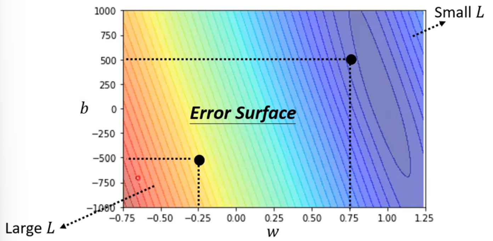
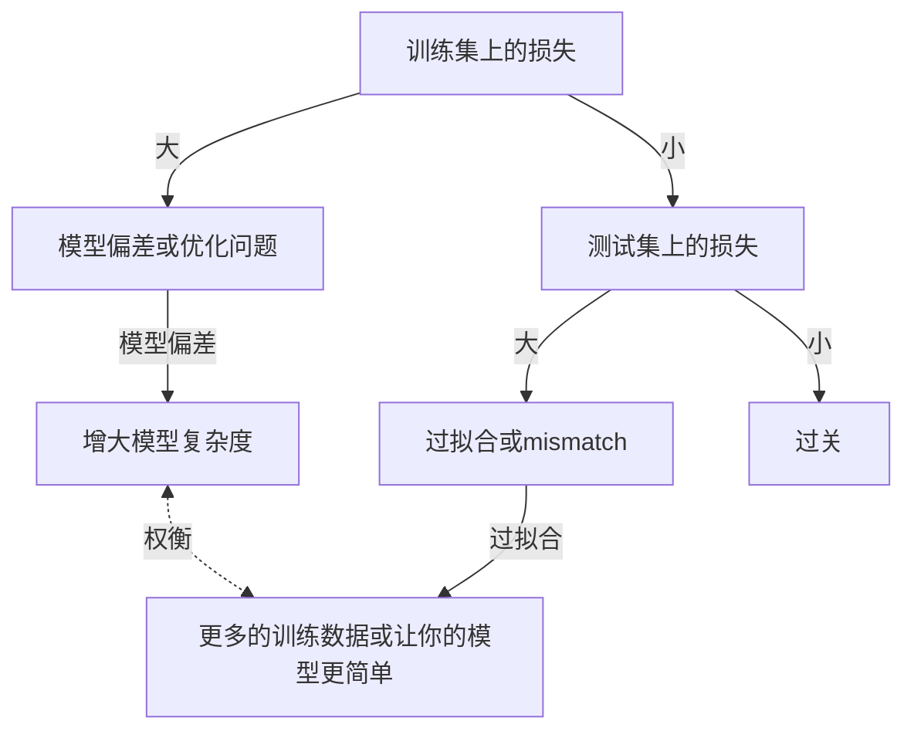
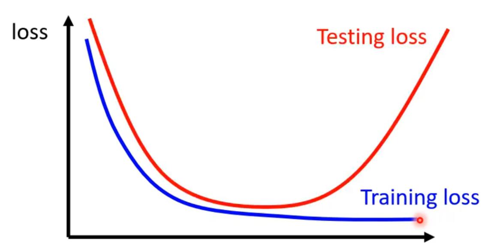
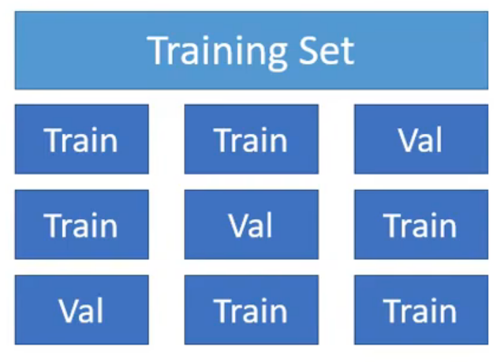
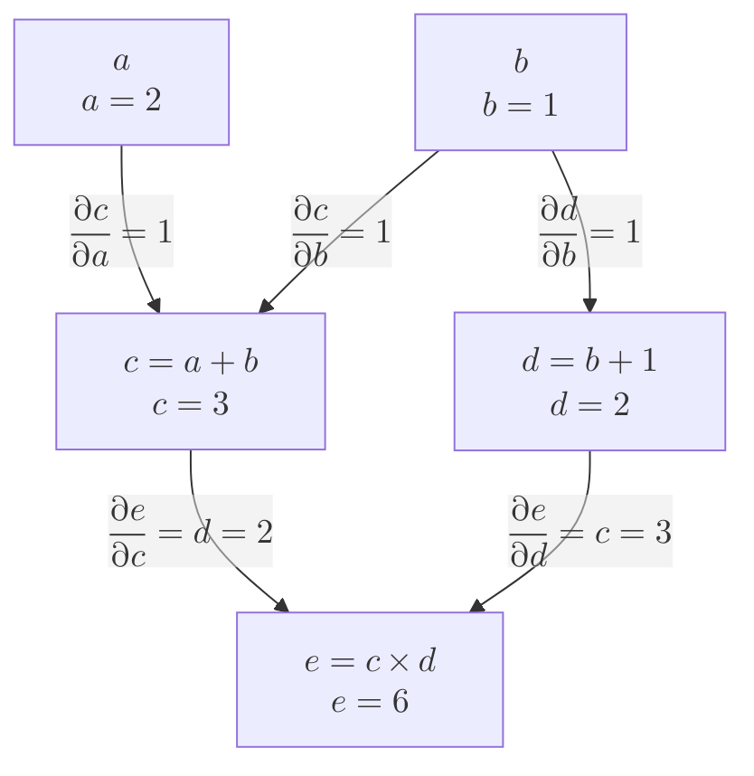

## 机器/深度学习简介

机器学习的任务：**寻找函数**
不同类型的函数：

- 回归（Regression）：函数输出为一个数值
- 分类（Classification）：给定一些类别，函数从中选择输出
- Structure Learning：让机器学会使用Structure创造

### 如何寻找函数（训练）

1. 猜测函数样式：$y=b+wx_1$
2. 定义损失函数：$L(b, w)$，定义一组参数有多好
   - mean absolute error(MAE)
   - mean square error(MSE)
   - 交叉熵（Cross-entropy）：如果 $y$ 和 $\hat{y}$ 是概率分布
   - 误差曲面：
     
3. 最小化损失函数：
   - 梯度下降（Gradient Descent）：
     1. 初始化参数
     2. 计算损失函数在此处的微分：$\frac{\partial L}{\partial w}|_{w=w^0}$
     3. 更新参数
        - 超参数（hyperparameters）：学习率（learning rate）
   - 随机梯度下降（SGD）
     - 将数据集划分为若干批量（batch）
     - update：根据一个batch更新一次参数
     - epoch：所有的batch都看过一遍

### 激活函数（activation function）

线性模型有他的偏差（bias）：无法拟合非线性函数。对于一个一般的曲线，我们可以使用若干个类似 __/-- 的折线去拟合它，这样就沿生出两个常用的激活函数：

- $$sigmoid=\frac{1}{1+e^{-z}}$$
- $$ReLU=max(0, z)$$

### 如何正确地训练？

> Mismatch: 训练数据与测试数据的分布不同。
> 这需要我们去留意测试数据和训练数据是如何产生的。

偏差方差权衡图：

这告诉我们要权衡好模型复杂度这一超参数的选择。

**如何选择超参数？**
在训练集中划分出验证集，使用验证集来验证超参数效果。但这又出现了一个问题：
**如何划分验证集？**
解决方法是k折交叉验证（k-fold Cross Validation）：

将训练数据集划分成k份，每一份轮流当验证集，对每个模型跑k轮，最终取平均作为这个模型的效果。

### 反向传播（Back Propagation）

对于深度神经网络，求函数解析式再对更新参数求偏导已经不再现实，对此我们引入了反向传播。
反向传播的核心在于计算图：

计算图先进行前馈过程，计算数值以及偏导；再进行反向传播，计算模型参数的梯度。
我们只需要定义一些原子计算的偏导的计算方法（矩阵乘法、卷积运算），即可计算每个参数的梯度。
$$\frac{\partial e}{\partial a}=\frac{\partial e}{\partial c} \cdot \frac{\partial c}{\partial a}$$
$$\frac{\partial e}{\partial b}=\frac{\partial e}{\partial c} \cdot \frac{\partial c}{\partial b}+\frac{\partial e}{\partial d} \cdot \frac{\partial d}{\partial b}$$
- 同路径相乘，不同路径相加